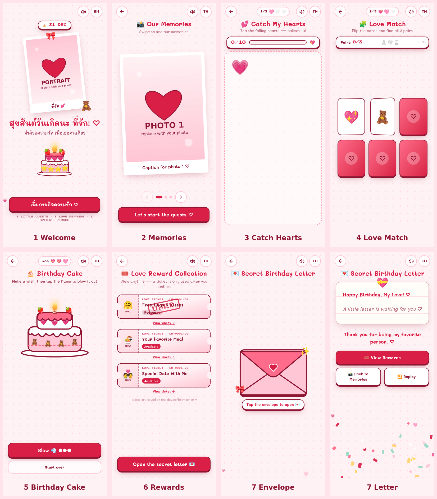

# 💗 LOVE QUEST: Template เว็บเกมวันเกิดให้แฟน

**3 Little Quests. 3 Love Rewards. 1 Special Person.**

เว็บเกมวันเกิดสำหรับเล่นบนมือถือ ส่งให้แฟนเป็นลิงก์เดียว ไม่ต้องลงแอป เล่นจบภายใน 3–5 นาที
ใน template นี้มีรูปตัวอย่างกับข้อความตัวอย่างใส่ไว้ให้แล้ว **แก้ไฟล์เดียวก็ได้เว็บของคุณเอง**



| หน้าจอ | สิ่งที่เกิดขึ้น |
| --- | --- |
| 1. Welcome 🎂 | รูปแฟนในกรอบโพลารอยด์, Happy Birthday, ปุ่มเริ่ม, ปุ่มเปิด/ปิดเสียง, ปุ่มสลับ TH/EN |
| 2. Our Memories 📸 | รูปหลายใบแบบปัดซ้ายขวา พร้อมคำบรรยาย และวิดีโอ (ไม่บังคับ) |
| 3. Catch My Hearts 💕 | แตะเก็บหัวใจที่ตกลงมาให้ครบ 10 ดวง ไม่มีจับเวลา ไม่มีแพ้ → ได้ตั๋ว #01 |
| 4. Love Match 🧩 | จับคู่การ์ด 3 คู่ → ได้ตั๋ว #02 |
| 5. Birthday Cake 🎂 | เลือกของแต่งเค้ก 3 อย่าง ปักเทียน แล้วแตะเป่า → ได้ตั๋ว #03 |
| 6. Reward Collection 🎟️ | ตั๋ว 3 ใบ เปิดดูได้ตลอด ตั๋วจะถูกใช้ก็ต่อเมื่อกดยืนยันเท่านั้น (ขึ้นตรา USED) |
| 7. Secret Letter 💌 | แตะเปิดซอง อ่านจดหมายที่คุณเขียนเอง แล้วต่อด้วยฉากจบ |

ความคืบหน้าและสถานะตั๋วจะถูกบันทึกในเบราว์เซอร์ รีเฟรชหน้าก็ไม่หาย เล่นซ้ำตั๋วก็ไม่หาย

---

## 🧰 สิ่งที่ต้องเตรียม

- รูป **4 รูป**: รูปหน้าแรก 1 รูป และรูปความทรงจำ 3 รูป (เพิ่มหรือลดได้)
- คลิปสั้น 1 คลิป (ไม่บังคับ) เป็นไฟล์ `.mp4` ขนาดไม่เกินประมาณ 20 MB
- คำอวยพรที่คุณเขียนเอง 💌
- บัญชี **GitHub** (ฟรี) และบัญชี **Vercel** (ฟรี, login ด้วย GitHub ได้)

---

## 🅰️ วิธีที่ 1: ไม่ต้องลงโปรแกรมอะไรเลย (แนะนำสำหรับมือใหม่)

ทำผ่านเว็บเบราว์เซอร์ทั้งหมด ใช้เวลาประมาณ 20–30 นาที

### Step 1: สร้าง repo ของตัวเอง
1. Login ที่ <https://github.com> แล้วกด **New repository**
2. ตั้งชื่อ เช่น `love-quest-birthday` เลือก **Private** แล้วกด **Create repository**
3. ในหน้า repo ที่ว่างอยู่ กดลิงก์ **uploading an existing file**
4. ลาก **ไฟล์และโฟลเดอร์ทั้งหมดที่อยู่ใน** โฟลเดอร์ template นี้ไปวาง
   - ต้องเห็น `package.json`, `src`, `public` อยู่ระดับบนสุดของ repo
   - **ไม่ต้อง** อัปโหลดโฟลเดอร์ `node_modules` และ `.next` (ถ้ามี)
5. กด **Commit changes**

### Step 2: เปลี่ยนรูป
1. ใน GitHub ไปที่ `public/memories/`
2. กด **Add file → Upload files** แล้วอัปโหลดรูปของคุณ **โดยใช้ชื่อไฟล์เดิม** เพื่อแทนที่ไฟล์ตัวอย่าง
   - `portrait.jpg` = รูปหน้าแรก
   - `memory-01.jpg`, `memory-02.jpg`, `memory-03.jpg` = รูปความทรงจำ
   - `memory-video.mp4` = คลิป (ไม่บังคับ ถ้าไม่มีไฟล์นี้ การ์ดคลิปจะไม่แสดง)
3. ตั้งชื่อไฟล์บนเครื่องให้ตรงก่อนอัปโหลด ถ้ารูปเป็น `.png` หรือ `.heic` ให้แปลงเป็น `.jpg` ก่อน (เช่น ใช้แอป Photos แล้ว Export เป็น JPEG)

> 💡 ควรย่อรูปให้ด้านยาวไม่เกินประมาณ 1600px (เว็บจะโหลดเร็วขึ้น) และลบข้อมูลตำแหน่ง GPS ในรูปออก ถ้าไม่อยากให้คนอื่นเห็น

### Step 3: ใส่ข้อความและคำอวยพร
1. เปิดไฟล์ `src/config/birthday.ts` แล้วกดไอคอน ✏️ (Edit)
2. แก้เฉพาะส่วนที่มีเครื่องหมาย ✏️ ในไฟล์ มี 11 จุดตามลำดับ:
   1. วันเกิด
   2. ชื่อที่ใช้เรียกแฟน
   3. ข้อความหน้าแรก
   4. รูปหน้าแรก
   5. รูปและคำบรรยาย
   6. ตั๋ว 3 ใบ
   7. **จดหมาย**
   8. ลายเซ็น
   9. ข้อความปิดท้าย
   10. เพลง
   11. ธีมสี
3. กด **Commit changes**

ตัวอย่างการใส่จดหมายหลายบรรทัด ให้ใช้ backtick `` ` `` ครอบข้อความ:

```ts
birthdayLetter: {
  th: `สุขสันต์วันเกิดนะ

ขอให้ปีนี้เป็นปีที่ดีที่สุด
รักนะ ♡`,
  en: "",
},
```

⚠️ **ข้อควรระวังตอนแก้ไฟล์**
- อย่าลบเครื่องหมาย `"` `,` `{` `}` ออกโดยไม่ตั้งใจ
- ถ้าข้อความมีเครื่องหมาย `"` อยู่ข้างใน ให้ครอบข้อความด้วย backtick `` ` `` แทน
- ถ้า deploy แล้ว build ไม่ผ่าน ส่วนใหญ่เป็นเพราะเครื่องหมายพวกนี้หาย

### Step 4: Deploy ขึ้นเว็บ
1. ไปที่ <https://vercel.com/new> แล้ว login ด้วย GitHub
2. กด **Import** ที่ repo `love-quest-birthday`
3. ไม่ต้องตั้งค่าอะไรเพิ่ม แล้วกด **Deploy**
   - ถ้าโค้ดอยู่ในโฟลเดอร์ย่อย เช่น `template/` ให้ตั้ง **Root Directory** เป็นโฟลเดอร์นั้นก่อนกด Deploy
4. รอประมาณ 1–2 นาที จะได้ลิงก์ เช่น `https://love-quest-birthday.vercel.app` 🎉

ทุกครั้งที่แก้ไฟล์ใน GitHub แล้วกด Commit ทาง Vercel จะ deploy ใหม่ให้อัตโนมัติ

### Step 5: ทดสอบก่อนส่ง
1. เปิดลิงก์บน **มือถือของคุณเอง** แล้วลองเล่นให้จบ 1 รอบ
2. ล้างข้อมูลที่เล่นทดสอบไว้ ใช้วิธีใดวิธีหนึ่ง
   - เปิดลิงก์ในแท็บ Private/Incognito ตั้งแต่ตอนทดสอบ หรือ
   - บนคอมพิวเตอร์: กด F12 → แท็บ Console → พิมพ์ `localStorage.removeItem("love-quest-birthday")` แล้วรีโหลดหน้า
3. **อย่าเปิดลิงก์บนเครื่องแฟนก่อนถึงวัน** เพราะเกมจำความคืบหน้าไว้ในเครื่องที่เปิด
4. ส่งลิงก์ให้แฟนในวันเกิด 💗

---

## 🅱️ วิธีที่ 2: รันบนคอมพิวเตอร์ (สำหรับคนเขียนโค้ดได้)

ต้องมี Node.js 20 ขึ้นไป (<https://nodejs.org>)

```bash
cd template              # หรือโฟลเดอร์ที่คุณแตกไฟล์ไว้
npm install
npm run dev              # เปิด http://localhost:3000
```

ลองเปิดบนมือถือที่ต่อ Wi-Fi เดียวกัน: รัน `npm run dev -- -H 0.0.0.0` แล้วเปิด `http://<IP-คอม>:3000`

ตรวจก่อน deploy:

```bash
npm run typecheck && npm run lint && npm run build
```

Deploy ด้วยคำสั่ง: `npx vercel --prod`

คำสั่งย่อขนาดคลิป (ต้องมี ffmpeg):

```bash
ffmpeg -i input.mov -vf "scale=-2:1280" -c:v libx264 -crf 26 -preset slow -c:a aac -b:a 128k -movflags +faststart public/memories/memory-video.mp4
```

---

## 🅲 วิธีที่ 3: ให้ AI (Claude Code) ทำให้

ดูไฟล์ **[PROMPT.md](PROMPT.md)** มี 2 แบบ
- **Prompt A**: มี template นี้อยู่แล้ว ให้ AI ช่วยใส่รูปและข้อความแทนคุณ
- **Prompt B**: Master Prompt สำหรับสร้างเกมทั้งหมดใหม่ตั้งแต่ศูนย์

---

## 🎨 ปรับแต่งเพิ่ม (ไม่บังคับ)

| อยากเปลี่ยน | แก้ตรงไหนใน `src/config/birthday.ts` |
| --- | --- |
| เพิ่มรูปเป็น 5 รูป | เพิ่ม object ใน `memories` แล้ววางไฟล์รูปใน `public/memories/` (`id` ห้ามซ้ำ) |
| เปลี่ยนรางวัล | `tickets`: แก้ `name`, `description`, `terms`, `emoji` ได้ (ต้องมี 3 ใบเสมอ) |
| ใส่เพลงพื้นหลัง | วางไฟล์ใน `public/music/song.mp3` แล้วตั้ง `music.src: "/music/song.mp3"` |
| เปลี่ยนโทนสี | `theme`: เปลี่ยนค่าสี hex เช่น โทนฟ้า `#EAF4FF`, `#BFDDFF`, `#5AA9FF`, `#1F6FD9`, `#123F7A` |
| เปิดมาเป็นภาษาอังกฤษ | `theme.defaultLanguage: "en"` |
| แฟนเป็นผู้หญิง / ไม่ระบุเพศ | ข้อความทั้งหมดแก้ได้ในไฟล์นี้ ข้อความตัวอย่างใช้คำกลาง ๆ อยู่แล้ว |

---

## 🔒 ความเป็นส่วนตัว

- รูปและคลิปใน `public/` เปิดดูได้ถ้ามีคนรู้ URL ของไฟล์ เว็บนี้ตั้งค่า `noindex` ไว้ Google จึงไม่ค้นเจอ แต่ **ไม่ใช่ระบบล็อก**
  ถ้าอยากเป็นความลับจริง ๆ ให้เปิด **Vercel → Settings → Deployment Protection** (ขึ้นกับแพ็กเกจ)
- ตั๋วและความคืบหน้าบันทึกใน **เบราว์เซอร์ของเครื่องที่เปิดเท่านั้น** ไม่ sync ข้ามเครื่อง
  - ถ้าล้างข้อมูลเบราว์เซอร์ ตั๋วจะหาย
  - ถ้าเปิดในโหมด Private ข้อมูลจะไม่ถูกเก็บถาวร

---

## ❓ ปัญหาที่พบบ่อย

| อาการ | วิธีแก้ |
| --- | --- |
| Deploy แล้ว build fail | ส่วนใหญ่เป็นเพราะ `"` หรือ `,` ใน `birthday.ts` หายไป ลองเทียบกับไฟล์ต้นฉบับ |
| รูปไม่ขึ้น (ขึ้นกรอบเปล่า) | ชื่อไฟล์ไม่ตรงกับ `src` ใน config ให้ระวังตัวพิมพ์เล็ก-ใหญ่ และ `.jpg` กับ `.jpeg` |
| คลิปไม่แสดง | ไฟล์ต้องชื่อ `memory-video.mp4` และเป็น MP4 แบบ H.264 (ถ้าเป็นไฟล์ HEVC/`.mov` จาก iPhone ให้แปลงก่อน) |
| อยากเริ่มเกมใหม่หมด | ล้าง localStorage ตามวิธีใน Step 5 |
| รูปถูกครอปจนหน้าหาย | ในหน้าแรก ให้ปรับ `portrait.objectPosition` ส่วนแกลเลอรีแสดงรูปเต็มอยู่แล้ว ไม่ครอป |

---

## 📁 โครงสร้างโปรเจกต์

```
src/config/birthday.ts   ← ✏️ แก้แค่ไฟล์นี้
public/memories/         ← 🖼️ รูปและคลิป
mockups/                 ← ภาพตัวอย่างหน้าจอ
src/components/screens/  ← โค้ด 7 หน้าจอ
src/components/ui/       ← ปุ่ม, ตั๋ว, เค้ก, confetti ฯลฯ
src/lib/                 ← ระบบบันทึก, ภาษา, เสียง
```

Tech: Next.js 15 · TypeScript · Tailwind CSS 4 · Motion · Lucide · localStorage ใช้ฟรีทั้งหมด ไม่มี backend
